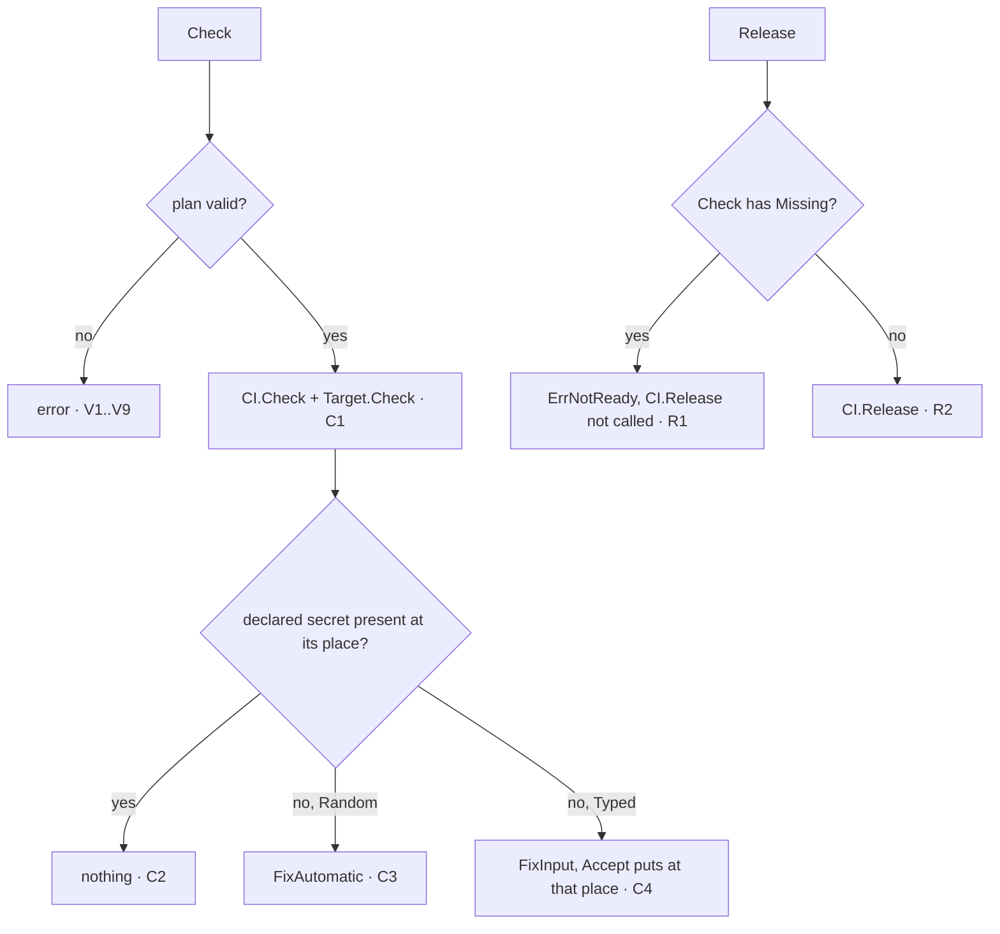

> Read AGENTS.md at the repo root before any change.

# Plan — deploy becomes the contract every deployment tool shares

Part of the "Despliegue guiado" wave (`https://github.com/webtyp/docs/blob/main/DEPLOY_WIZARD_MASTER_PLAN.md`,
decisions D3, D13–D16, D26, D29, D34–D36). Today this repo mixes a contract with implementations:
it imports `goflare`, registers Cloudflare/SSH/webhook "pushers" in `init()`, ships a Windows
"Puller" nobody uses, and decides which keys are secret with a hard-coded list. After this plan it
holds **only types, interfaces, the reader of a project's declaration, and the generic orchestration
over those interfaces**. Implementations (`webtyp/goflare`, `webtyp/github`) import it;
`webtyp/app` composes them.

## Tools

```bash
go install webtyp.com/devflow/cmd/gotest@latest
go install webtyp.com/lang/cmd/langc@latest
```

## Design gate

1. **Prior art.** SST (`sst.config.ts`: infrastructure declared in code), Encore (infrastructure
   inferred from Go code), Fly (`fly.toml` + `fly launch` asks only for what is missing),
   Kamal (`config/deploy.yml` + secret adapters). Here the declaration is a Go literal **read by
   AST without running the project**, like `config/routes.go` in `webtyp/router/routescan`.
2. **Names.** `Plan` (what to deploy), `Deployment` (a plan with its tools), `Target` (where it
   runs), `CI` (who runs the deploy), `Destination` (a place that receives secrets), `Missing`
   (something still needed), `Scan` (read the declaration). Rejected: `Pusher`, `Puller`, `Sink`.
3. **Ledger.** Concepts +7 / −6 (`Provider`, `Pusher`, `Puller`, `Daemon`, `SecureStore`,
   `Config`). Ways to declare a deploy: `deploy.yaml` + wizard menu + `.env` keys → one
   (`config/deploy.go`). Ways to store a secret: −1 (`SecureStore` deleted).
4. **Where.** Contracts and the orchestration over them are written once, here. No implementation
   lives here; this module requires only `webtyp.com/lang` (and what it pulls).
5. **Deletes.** Everything currently in the repo except `LICENSE`, `go.mod`, `docs/img/` (see
   Stage 1).

## Stage 1 — delete the current implementation

Delete these files and directories:

- `checker.go`, `composer.go`, `config.go`, `downloader.go`, `handler.go`, `hmac.go`,
  `manager.go`, `manager_default.go`, `provider.go`, `puller.go`, `pusher.go`,
  `pusher_cloudflare.go`, `pusher_ssh.go`, `shortcut_linux.go`, `shortcut_windows.go`, `ssh.go`,
  `store.go`, `webhook.go`, `wizard.go`
- `providers/`, `cmd/`, `tests/` (every file)
- `docs/ARQUITECTURE_DESIGN.md`, `docs/IMPLEMENTATION_GUIDE.md`, `docs/diagrams/`,
  `docs/PLAN_pre_webtyp_migration.md`

Do not port any of it. `go mod tidy` must drop `goflare`, `keyring`, `wizard`, `update`,
`gopkg.in/yaml.v3` and their indirect requirements.

## Stage 2 — the declaration types

New file `plan.go`:

```go
package deploy

import "webtyp.com/lang"

// TargetID names a deployment target implementation as "<import path>.<constant>",
// e.g. "webtyp.com/goflare.Worker". The implementing package exports a constant of
// this type whose value is exactly that text; a project writes the constant.
type TargetID string

// CIID names a CI implementation the same way, e.g. "webtyp.com/github.Actions".
type CIID string

// Plan is what a project declares in config/deploy.go.
type Plan struct {
	Name      string   // service name, e.g. "misitio"
	Domain    string   // custom domain; "" = none
	Target    TargetID // where it runs
	CI        CIID     // who runs the deploy
	Databases []Database
	Buckets   []Bucket
	Secrets   []Secret
}

// Database is a SQL database the deployed code reaches through Binding.
type Database struct {
	Binding string // name the code uses, e.g. "DB"
	Name    string // resource name at the provider, e.g. "velty-misitio-db"
}

// Bucket is an object store the deployed code reaches through Binding.
type Bucket struct {
	Binding string
	Name    string
}

// Source says where a secret's value comes from.
type Source uint8

const (
	Typed  Source = iota + 1 // a person types it in the wizard (provider without an API)
	Random                   // generated: 32 random bytes, base64url without padding
)

// Place says who reads a secret.
type Place uint8

const (
	ToRuntime Place = iota + 1 // the deployed app, at run time
	ToCI                       // the CI job that deploys
	ToLocal                    // the local development server of each person
)

// Secret is a value the project needs that grants access.
type Secret struct {
	Key    string      // e.g. "IAM_CLIENT_PRIVATE_KEY"
	What   lang.Text   // what it is, in one plain sentence (English; translated)
	Source Source
	Guide  []lang.Text // for Typed: the steps to obtain it, shown one per line
	To     []Place
}
```

Zero values deny: `Source(0)` and `Place(0)` are invalid and rejected by validation (Stage 4).

## Stage 3 — what is missing, and the interfaces

New file `missing.go`:

```go
// Fix says how a Missing item is resolved.
type Fix uint8

const (
	FixAutomatic Fix = iota + 1 // Deployment.Provision resolves it, no input needed
	FixInput                    // a person types a value; Accept receives it
	FixManual                   // a person acts outside webtyp (Steps), then checks again
)

// Missing is one thing a deployment still needs. It never carries a secret value.
type Missing struct {
	Item   lang.Text   // short name, e.g. "Cloudflare bootstrap token"
	Why    lang.Text   // what breaks without it
	Steps  []lang.Text // how to get it (FixInput, FixManual)
	Fix    Fix
	Secret bool                     // FixInput: the value must be masked
	Accept func(value string) error // FixInput only: stores or delivers the value
}
```

New file `interfaces.go`:

```go
// Destination receives secrets. It is write-only: it can say whether a key
// exists, never return a value.
type Destination interface {
	Has(key string) (bool, error)
	Put(key, value string) error
}

// Input is one named input of a CI job.
type Input struct{ Name, Value string }

// Job is the single CI step a Target needs to deploy: an action reference,
// its inputs, and the names of the CI secrets it reads as environment variables.
type Job struct {
	Uses    string   // e.g. "tinywasm/goflare@v1"
	With    []Input
	Secrets []string // e.g. "CLOUDFLARE_API_TOKEN"
}

// Target is where the project runs (implemented by webtyp/goflare, ...).
type Target interface {
	ID() TargetID
	// Check reports what the target still needs (credentials, resources,
	// its own CI secrets in ci). It changes nothing.
	Check(p Plan, ci Destination) ([]Missing, error)
	// Provision creates what is missing and delivers the target's own CI
	// secrets to ci. Idempotent: never replaces a secret that exists.
	Provision(p Plan, ci Destination) error
	// Rotate replaces every production secret the target owns.
	Rotate(p Plan, ci Destination) error
	// Runtime is where ToRuntime secrets go.
	Runtime(p Plan) Destination
	// Job is the CI step that deploys p.
	Job(p Plan) Job
}

// RunState is the state of a CI run.
type RunState uint8

const (
	RunQueued RunState = iota + 1
	RunInProgress
	RunSucceeded
	RunFailed
)

// Run identifies one CI run.
type Run struct {
	ID  string
	URL string
}

// CI runs the deploy (implemented by webtyp/github, ...).
type CI interface {
	ID() CIID
	Check(p Plan, job Job) ([]Missing, error)
	Provision(p Plan, job Job) error // writes or updates the deploy workflow
	Secrets(p Plan) Destination      // where ToCI secrets go
	Release(p Plan) (Run, error)
	Status(r Run) (RunState, error)
}
```

## Stage 4 — `Deployment`, the one orchestration

New file `deployment.go`:

```go
// Deployment is a Plan with the tools that carry it out. Local is the
// person's project keyring (ToLocal secrets); app builds it.
type Deployment struct {
	Plan   Plan
	Target Target
	CI     CI
	Local  Destination
}

func (d Deployment) Check() ([]Missing, error)
func (d Deployment) Provision() error
func (d Deployment) Rotate() ([]Missing, error)
func (d Deployment) Release() (Run, error)
func (d Deployment) Status(r Run) (RunState, error)
```

Behaviour (exactly this order):

- **Validation** (unexported `validate(p Plan) error`, called first by every method and by `Scan`):
  `Name`, `Target`, `CI` non-empty; every `Database`/`Bucket` has `Binding` and `Name`; every
  `Secret` has a non-empty `Key` (unique in the plan), non-empty `What`, a valid `Source`, at least
  one `To`, each a valid `Place`, no `Place` repeated; `Guide` non-empty when `Source == Typed`;
  `Target.ID() == Plan.Target` and `CI.ID() == Plan.CI`. Each failure is a distinct error constant
  (Stage 6). A nil `Target`, `CI` or `Local` is an error, never a panic.
- **Check**: `CI.Check(p, Target.Job(p))`, then `Target.Check(p, CI.Secrets(p))`, then, for every
  declared secret and every place in `To`, `dest.Has(key)` on that place's destination
  (`ToRuntime` → `Target.Runtime(p)`, `ToCI` → `CI.Secrets(p)`, `ToLocal` → `Local`). Absent →
  one `Missing`: `Item = secret.What`, `Why` = the place's text (Stage 6), `Fix = FixAutomatic` for
  `Random`, `FixInput` with `Secret: true`, `Steps = secret.Guide` and
  `Accept = func(v) error { return dest.Put(key, v) }` for `Typed`. Results keep that order.
- **Provision**: `Target.Provision(p, CI.Secrets(p))`, then `CI.Provision(p, Target.Job(p))`, then
  every absent `Random` secret is generated and `Put` to its place. Never touches a present secret.
- **Rotate**: `Target.Rotate(p, CI.Secrets(p))`; every `Random` secret is regenerated and `Put` to
  all its places (overwriting); returns one `FixInput` `Missing` per `Typed` secret and place,
  whose `Accept` overwrites it.
- **Release**: `Check`; any `Missing` → `ErrNotReady` wrapping the English `Item`s joined by `", "`;
  else `CI.Release(p)`.
- **Status**: `CI.Status(r)`.

Random values: 32 bytes from `crypto/rand`, `base64.RawURLEncoding`.

## Stage 5 — `Scan`: read `config/deploy.go` without running it

New file `scan.go`:

```go
// DefaultFile is where a project declares its deployment.
const DefaultFile = "config/deploy.go"

// Scan reads rootDir/DefaultFile and returns the Plan its Deploy function
// returns. Only literals are allowed; anything else is an error naming the
// file and line. A missing file is ErrNoPlan.
func Scan(rootDir string) (Plan, error)
```

The file must contain `func Deploy() deploy.Plan { return deploy.Plan{ ... } }` (any import alias
for `webtyp.com/deploy`). It starts with `//go:build deploy`: `config` is compiled into the
project's Worker, browser client and server, and none of them may link the deployment tools it
imports. `Scan` ignores build constraints (it parses the one file); `webtyp/app` checks that the
declaration compiles with `go vet -tags deploy ./config/`. A file without that exact first
constraint line is an error (`ErrMissingBuildTag`). Accepted expressions:

| Field | Accepted |
|---|---|
| `Name`, `Domain`, `Binding`, `Name`, `Key`, `What`, each `Guide` element | string literal (`"..."` or raw) |
| `Target`, `CI` | selector `pkg.Const`, resolved through the file's imports to `"<import path>.Const"` (e.g. `goflare.Worker` with `import "webtyp.com/goflare"` → `"webtyp.com/goflare.Worker"`) |
| `Source`, each `To` element | selector on the `webtyp.com/deploy` import: `Typed`, `Random`, `ToRuntime`, `ToCI`, `ToLocal` |
| `Databases`, `Buckets`, `Secrets`, `Guide`, `To` | composite literal; element types may be elided |

Unknown field, function call, identifier, binary expression or any other node → error
`"<path>:<line>: <reason>"`, with `<reason>` one of the Stage 6 constants. After reading, `Scan`
runs `validate`. Use `go/parser` and `go/ast` (stdlib is correct here, see AGENTS.md).

## Stage 6 — errors and texts

`errors.go`: one exported `var Err... = errors.New("...")` per failure, English, e.g.
`ErrNoPlan = errors.New("no deployment declared: create config/deploy.go with func Deploy() deploy.Plan")`,
`ErrNotReady = errors.New("deployment not ready")`, `ErrOnlyLiterals`, `ErrUnknownField`,
`ErrNoName`, `ErrNoTarget`, `ErrNoCI`, `ErrTargetMismatch`, `ErrCIMismatch`, `ErrDuplicateSecret`,
`ErrInvalidSource`, `ErrInvalidPlace`, `ErrNoPlace`, `ErrNoGuide`, `ErrNoWhat`, `ErrIncompleteDatabase`,
`ErrIncompleteBucket`, `ErrNilTool`, `ErrMissingBuildTag` ("config/deploy.go must start with //go:build deploy"). Wrap with `%w` and context (file:line, secret key).

`texts.go`:

```go
const (
	textWhyRuntime lang.Text = "The deployed app cannot start without it"
	textWhyCI      lang.Text = "The CI cannot deploy without it"
	textWhyLocal   lang.Text = "The local development server needs it"
)
```

`lang.json` (8 columns `es zh hi ar pt fr de ru`; `es` mandatory, the rest may be empty) and
`dictionary.go` with `func Dictionary() []byte` over the embedded file, exactly like
`https://github.com/webtyp/devtui/blob/main/dictionary.go`. Run `langc sync`.

## Stage 7 — tests (`tests/`, external package)

Fakes at the edge only: an in-memory `Destination`, a fake `Target` and a fake `CI` that record
calls. Declarations as files under `tests/testdata/<case>/config/deploy.go`.



| Branch | Test |
|---|---|
| S1 | misitio-like declaration (selectors with and without alias, raw strings, elided types) → exact `Plan` |
| S2 | no file → `ErrNoPlan` |
| S3 | a call, a variable, an unknown field → `ErrOnlyLiterals`/`ErrUnknownField` with `config/deploy.go:<line>` |
| S4 | file without `//go:build deploy` → `ErrMissingBuildTag` |
| V1–V9 | one test per validation error constant |
| C1 | CI and Target `Missing` come first, in that order |
| C2–C4 | as in the diagram; C4 calls `Accept("v")` and the fake destination now holds `v` |
| C5 | a secret with `To: {ToRuntime, ToLocal}` absent in both → two `Missing`, one per place |
| P1 | `Provision` generates absent `Random` secrets (43 base64url chars) and never overwrites a present one |
| P2 | `Rotate` overwrites every `Random` secret and returns one `FixInput` per `Typed` secret and place |
| R1–R2 | as in the diagram |
| N1 | a `Deployment` with a nil `Target` returns `ErrNilTool`, no panic |
| L1 | with `lang.Load(deploy.Dictionary())` and `lang.OutLang("es")`, `textWhyCI` translates to the `es` column |

## Stage 8 — docs

Rewrite `README.md`: what the module is (contracts only), a complete `config/deploy.go` example
(the misitio declaration below), the `Deployment` methods, and the rule that implementations import
`deploy`, never the reverse. Example to use verbatim:

```go
//go:build deploy

package config

import (
	"webtyp.com/deploy"
	"webtyp.com/github"
	"webtyp.com/goflare"
)

func Deploy() deploy.Plan {
	return deploy.Plan{
		Name:      "misitio",
		Domain:    "misitio.velty.cl",
		Target:    goflare.Worker,
		CI:        github.Actions,
		Databases: []deploy.Database{{Binding: "DB", Name: "velty-misitio-db"}},
		Buckets:   []deploy.Bucket{{Binding: "ASSETS", Name: "velty-misitio-assets"}},
	}
}
```

| Stage | Files |
|---|---|
| 1 | deletions listed in Stage 1; `go.mod`, `go.sum` |
| 2 | `plan.go` |
| 3 | `missing.go`, `interfaces.go` |
| 4 | `deployment.go` |
| 5 | `scan.go` |
| 6 | `errors.go`, `texts.go`, `lang.json`, `dictionary.go` |
| 7 | `tests/*_test.go`, `tests/testdata/**` |
| 8 | `README.md` |

## Acceptance

- `gotest` green.
- `grep -rn "goflare\|keyring\|wizard\|yaml\|Puller\|Pusher\|SecureStore" --include=*.go --include=go.mod .` → empty.
- `go list -deps . | grep "^webtyp.com/"` lists only `webtyp.com/lang`, `webtyp.com/fmt` and what `lang` requires.
- `test ! -e providers && test ! -e cmd && test ! -e store.go`.
- `git diff --stat main` lists every file of the stages table; no other file deleted.
